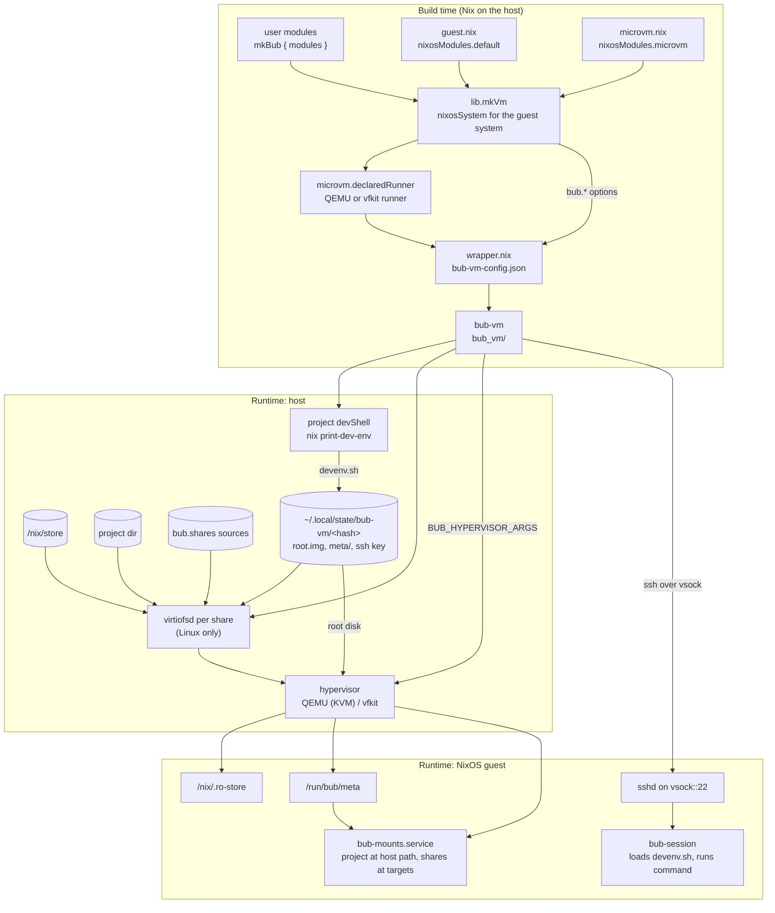

# bub

An easy to use, general purpose sandboxing setup using micro VMs via Nix.

## Prerequisites
- Linux or macOS
- Nix with the `nix-command` and `flakes` experimental features enabled

> [!NOTE]
> For macOS, only Apple Silicon is supported. You'll also need to set up a Linux builder.

## Try it

```bash
nix run github:LCLPYT/bub -- bash
```

This creates a microVM running NixOS and opens an interactive shell running `bash`.
Learn more about how to [manage VMs](#managing-vms) created by bub further below.

## Motivation

Need a way to easily sandbox a program?
There are a couple of good options to do that, such as using containers, bubblewrap or VMs.

I needed something flexible, that could run almost everything that can be run on my host machines.

For example, if you want to use coding agents, many projects usually require the invocation of separate programs, such as Docker, to build and test programs.
Running Docker inside of containers (i.e. Docker-in-Docker) is possible, but also a pain to set up.
It also poses security issues since most of the time you mount the host Docker socket into the container.

It may also be that you got containers working inside a container, but maybe you need some other tool in the future, such as QEMU or Nix, which require specialized setup once again.
To spare me from this hassle, I turned to using VMs.

My requirements were that I needed a setup which runs both on my Linux systems, as well as on macOS.
I need to run Podman, Nix and QEMU inside the VM, but further extensions should be easily possible.

This is why I decided that [microvm.nix](https://github.com/microvm-nix/microvm.nix) is the right tool for the job.
It only requires the Nix package manager, which is available for all major platforms.
On top of that, Nix also offers a very large software repository with convenient ways to install new software and also per-project tools.

For best performance, virtiofs and other virtio drivers are required.
This is why the following hypervisors are chosen:

| Host             | Hypervisor | Guest           |
|------------------|------------|-----------------|
| `x86_64-linux`   | QEMU (KVM) | `x86_64-linux`  |
| `aarch64-linux`  | QEMU (KVM) | `aarch64-linux` |
| `aarch64-darwin` | vfkit      | `aarch64-linux` |

## How it works

This setup consists of three major components:
- Guest system built using Nix (on the host)
- Host system state (folder shares, vm state, disk)
- Guest system (the running VMs)

The following diagram sketches how the setup looks like on your machine:


Once you run `bub-vm` inside a folder, that folder will be mounted into a new VM with read/write permissions.
Each working directory gets an individual VM, meaning you get easy isolation between your projects.
VMs also get re-used after you restart them inside a folder.

This also means that having many VMs consumes a bit more disk space, since each VM gets its own disk image in `~/.local/state/bub-vm`.
In order to save disk space, the VM images are created as sparse files.
Should you want to delete VMs, please read [Managing VMs](#managing-vms).

Detailed implementation documentation is available [here](docs/implementation.md).

## Installation

### Nix flake
Add bub as an input to your nix flake:

```nix
inputs.bub-vm = {
  url = "github:LCLPYT/bub";
  inputs.nixpkgs.follows = "nixpkgs";
};
```

Then, you can use the builtin function `mkBub` to create a package for your system / home manager packages.

```nix
environment.systemPackages = [
  (inputs.bub-vm.lib.mkBub {
    system = pkgs.stdenv.hostPlatform.system;
    modules = [
      ({ pkgs, ... }: {
        # you can customize the user id within the vm
        # bub.uid = 1001;

        # additional packages installed in the vm
        environment.systemPackages = with pkgs; [
          nodejs
        ];

        # customize specs
        microvm.mem = 8192;
        microvm.vcpu = 4;

        # further guest system settings...
      })
    ];
  })
]
```

### Generic flake + profile (e.g. on non-NixOS systems)
You can write a small flake to customize the vm config and install it as profile:

```nix
# ~/.config/bub-vm/flake.nix
{
  inputs = {
    nixpkgs.url = "github:NixOS/nixpkgs/nixos-unstable";
    bub-vm = {
      url = "github:LCLPYT/bub";
      inputs.nixpkgs.follows = "nixpkgs";
    };
  };

  outputs = { bub-vm, ... }: {
    packages.x86_64-linux.default = bub-vm.lib.mkBub {
      system = "x86_64-linux";
      modules = [
        ({ pkgs, ... }: {
          environment.systemPackages = [ pkgs.nodejs ];
          microvm.mem = 8192;
        })
      ];
    };
  };
}
```

Then:

```bash
nix profile install ~/.config/bub-vm               # first install
nix flake update --flake ~/.config/bub-vm          # bump bub/nixpkgs
nix profile upgrade --all                          # rebuild after editing or updating
```

## Customization

### Directory shares

You can mount host directories into the VM using `bub.shares`:
```nix
bub.shares = {
  # relative: inside the home directory of the VM user (~/.claude)
  claude = { 
    source = "~/.local/share/bub-vm/claude";
    target = ".claude";
  };

  # absolute: at the given path
  models = { 
    source = "/mnt/models";
    target = "/data/models";
    readOnly = true;  # optionally, set a mount to readonly
  };

  # no target: at the same path as on the host, e.g. for sibling repositories
  libs = { source = "~/src/shared-libs"; };
};
```

Targets can't be system directories (`/etc`, `/nix`, `/run`, ...) or the home directory itself, and two shares can't use the same target. 

> [!NOTE]
> MacOS doesn't truly support `readOnly = true` shares.
> If your VM guest user can elevate to root inside the VM, they can bypass the readonly mount.
> On Linux, this problem doesn't exist, since virtiofsd enforces this.

### Example: Claude Code

If you want to use Claude Code in the VM, you can add it as general package in the guest:

```nix
(inputs.bub-vm.lib.mkBub {
  system = pkgs.stdenv.hostPlatform.system;
  modules = [
    ({ config, lib, pkgs, ... }: {
      nixpkgs.config.allowUnfreePredicate = pkg: lib.getName pkg == "claude-code";

      environment.systemPackages = [ pkgs.claude-code ];

      # mounts ~/.local/share/bub-vm/claude on the host at ~/.claude in the vm
      bub.shares.claude = {
        source = "~/.local/share/bub-vm/claude";
        target = ".claude";
      };

      environment.variables = {
        CLAUDE_CONFIG_DIR = "/home/${config.bub.user}/.claude";
        DISABLE_AUTOUPDATER = "1";
        DISABLE_TELEMETRY = "1";
        DISABLE_ERROR_REPORTING = "1";
      };
    })
  ];
})
```

### Example: Podman

Rootless Podman works out of the box with:

```nix
({ ... }: {
  virtualisation.podman = {
    enable = true;
    dockerCompat = true;
  };
})
```

### Example: Nix inside the VM

Nix is disabled in the guest by default. 
It can be enabled with a writable store overlay:

```nix
({ config, lib, ... }: {
  nix.enable = lib.mkForce true;
  
  nix.settings = {
    experimental-features = [ "nix-command" "flakes" ];
    trusted-users = [ config.bub.user ];
  };

  microvm.writableStoreOverlay = "/nix/.rw-store";

  # store paths built in the VM live on the per-project root disk
  bub.diskSize = 64 * 1024;
})
```

The host store stays read-only: it is mounted at `/nix/.ro-store` and covered by an overlayfs whose upper layer is on
the per-project root disk, so builds inside the VM can't write to the host store.

Only the closure of the guest system is registered in the Nix database of the VM. Other host store paths (e.g. from the devShell) are visible, but Nix in the VM treats them as missing and builds or downloads them again.

Builds run in the default `build-dir` (`/nix/var/nix/builds`), which is on the root disk.
Don't point `build-dir` below a world-writable directory such as `/var/tmp`: Nix refuses that with: `Path "/var/tmp" is world-writable or a symlink`.

### Example: Nested virtualization (QEMU / NixOS tests)

To run QEMU with KVM inside the VM, e.g. for `nixosTest` checks or `system.build.vm`, enable `bub.nestedVirtualization.enable`. 
It gives the VM user access to `/dev/kvm` and, on macOS, starts vfkit with `--nested`.

On Linux hosts, nested virtualization also has to be enabled in the KVM module of the host:

```bash
cat /sys/module/kvm_intel/parameters/nested   # or kvm_amd, should print Y or 1
```

Configure your VM settings:
```nix
({ pkgs, ... }: {
  bub.nestedVirtualization.enable = true;

  # x86_64 guests only, the aarch64 kernel has KVM built in
  boot.kernelModules = [ "kvm-intel" ]; # or "kvm-amd"

  # nested VMs need resources
  microvm.mem = 16384;
  microvm.vcpu = 8;
})
```

Check with `ls -l /dev/kvm` and `grep -cE 'vmx|svm' /proc/cpuinfo` in the VM.

Nested virtualization on `aarch64-linux` needs hardware support and `kvm-arm.mode=nested` on the host kernel.
On macOS, nested virtualization requires an M3 or newer and macOS 15. 
Otherwise vfkit refuses to start with `nested virtualization is not supported` (see `bub-vm --log`). 

Without KVM, QEMU falls back to slow software emulation.

### Options

| Option                | Default                         | Description                                                        |
|-----------------------|---------------------------------|--------------------------------------------------------------------|
| `bub.user`            | `bub`                           | Name of the user inside the VM.                                    |
| `bub.uid`             | `501` on macOS, `1000` on Linux | UID of the VM user. Must match the host user.                      |
| `bub.diskSize`        | `32768` (MiB)                   | Size of the sparse per-project root disk.                          |
| `bub.shares`          | `{ }`                           | Host directories mounted into the VM, see [Directory shares](#directory-shares). |
| `bub.network.enable`  | `true`                          | NAT network with access to the host network and the internet.      |
| `bub.sudo.enable`     | `true`                          | Passwordless sudo for the VM user.                                 |
| `bub.nestedVirtualization.enable` | `false`             | KVM inside the VM, see [Nested virtualization](#example-nested-virtualization-qemu--nixos-tests). |
| `bub.keepRunning`     | `false`                         | Keep the VM running after the last session (`BUB_KEEP_RUNNING`).   |
| `bub.devShell.enable` | `true`                          | Load the devShell of the project flake (`BUB_DEVSHELL`).           |
| `bub.forwardEnv`      | `[ "COLORTERM" ]`               | Environment variables passed from the host to sessions.            |

Packages are added with `environment.systemPackages`, and any other NixOS or microvm.nix option (e.g. `microvm.mem`,
`microvm.vcpu`) can be set as well.

## Disk usage

Every project has its own root disk at `~/.local/state/bub-vm/<hash>/root.img`.
If you have local state / cache in the VM, such as a `node_modules` folder or container image layers, they will potentially be duplicated if they are used in multiple VMs.

The disk is a sparse file, so it only uses what has been written, but it grows up to `bub.diskSize` and doesn't necessarily shrink again when files are deleted in the VM. 

A solution to that is to share such directories from the host with all the VMs using [`bub.shares`](#directory-shares), e.g. for `~/.npm`. 
Don't do this for the Nix store, see [Nix inside the VM](#example-nix-inside-the-vm).

## Managing VMs

```bash
bub-vm claude        # run a program (needs to be installed in the guest)
bub-vm               # interactive shell
bub-vm --stop        # stop the VM of this directory
bub-vm --destroy     # delete the VM disk of this directory
bub-vm --log         # console output
bub-vm --list        # all VMs with their project, status, last use and disk usage
bub-vm --remove 8c66 # delete a VM by (a prefix of) its hash or by its project path, asks first
bub-vm --gc          # delete VMs whose project directory no longer exists
bub-vm --gc --older-than 30   # ... and VMs not used for 30 days
```

## Project tools

If the project has a `flake.nix` with `devShells.<guest-system>.bub` (or `.default`), it is built **on the host** with `nix print-dev-env` and sourced in every session. 

Because the project directory is writable from inside the VM, its Nix files are untrusted: building them runs code on the host. 
bub-vm therefore asks for confirmation whenever the `*.nix` files or `flake.lock` change.

> [!WARNING]
> The security confirmation can easily be bypassed by the host, e.g. by importing other files.
> Therefore, always review changes to the project nix flake, especially when using coding agents.

Set `bub.devShell.enable = false` or `BUB_DEVSHELL=0` to skip the devShell.

## Other versions

Before switching to microVMs, bub was a set of shell scripts. They are no longer maintained, but kept in [`archive/`](archive):
- [`archive/bubblewrap`](archive/bubblewrap/README.md): Linux sandbox using [bubblewrap](https://github.com/containers/bubblewrap) namespaces and a [tinyproxy](https://github.com/tinyproxy/tinyproxy) allow list for network access.
- [`archive/macos`](archive/macos/README.md): macOS sandbox using [Apple containers](https://github.com/apple/container).
