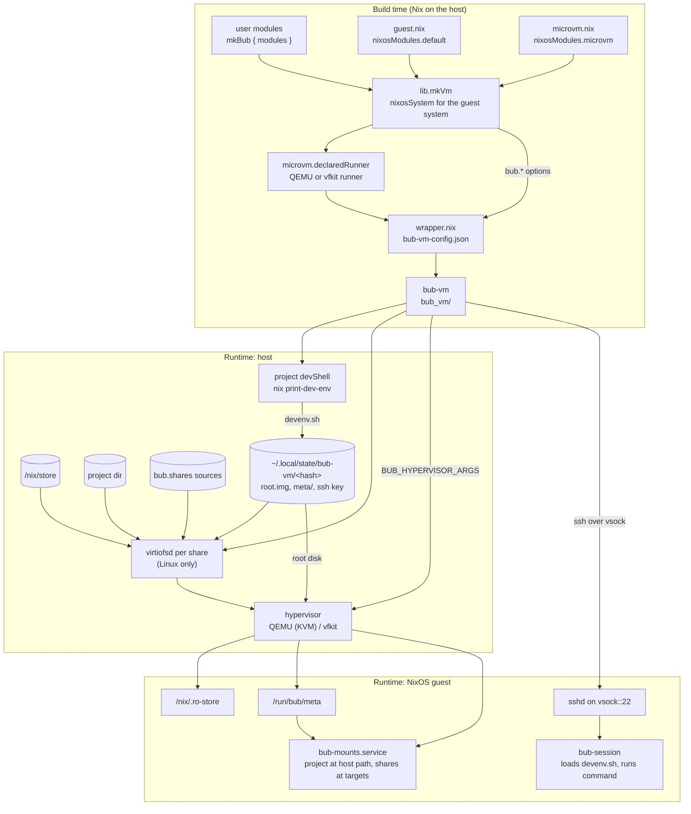

# bub

A general sandboxing setup using a micro vm.
Utilizes [Nix](https://nixos.org/download/) in order to set up reusable microvms.

NixOS is being used as guest system.
The guest system is built on the host and then mounted into the VM.

Each process gets its own VM instance, depending on the working directory you run them in.

## Why a micro vm?

There a few different sandboxing approaches, each with pros and cons.

Using containers, you can get good sandboxing with filesystem isolation. 
However if you ever need to run more complex setups, such as a coding agent, they may need to interact with Docker / Podman themselves in order to be more effective at what they are doing.
Docker-in-Docker would be possible, but also very painful to setup, so this is maybe not ideal.

Using a VM makes it possible to run a complete Linux system and provides a way to do nearly everything that you can do on a real host.
Additonally, using a hypervisor accomplishes strong isolation from programs like coding agents from your host file system.

**TLDR**: Use Micro VMs, because:
- stronger isolation compared to containers
- more flexibility in running software like Podman inside the sandbox

## Prerequisites
- a modern Linux system or macOS (Apple Silicon)
- Nix package manager

On macOS, you'll also need a Linux aarch64 builder. It can be set up using [nix-darwin](https://github.com/nix-darwin/nix-darwin), for example.

## Try it
You can try the sandbox without installing it using nix:

```bash
nix run github:LCLPYT/bub?dir=microvm -- bash
```

## Installation

### Default config
You can install the default configuration system-wide (no customization; see below for customizing the vm):

```bash
nix profile install github:LCLPYT/bub?dir=microvm
```

### Via home-manager (supports customization)

```nix
home.packages = [
  (inputs.bub-vm.lib.mkBub {
    system = pkgs.stdenv.hostPlatform.system;
    modules = [
      ({ pkgs, ... }: {
        # custom user id within the vm
        bub.uid = 1001;

        # additional packages installed in the vm
        environment.systemPackages = with pkgs; [
          nodejs
        ];

        # customize ram
        microvm.mem = 8192;
      })
    ];
  })
];
```

### Generic flake + profile (e.g. on non-NixOS systems)
You can write a small flake to customize the vm config and install it as profile:

```bash
# ~/.config/bub-vm/flake.nix
{
  inputs = {
    nixpkgs.url = "github:NixOS/nixpkgs/nixos-unstable";
    bub-vm = {
      url = "github:LCLPYT/bub?dir=microvm";
      inputs.nixpkgs.follows = "nixpkgs";
    };
  };

  outputs = { bub-vm, ... }: {
    packages.x86_64-linux.default = bub-vm.lib.mkBub {
      system = "x86_64-linux";
      modules = [
        ({ pkgs, ... }: {
          environment.systemPackages = [ pkgs.nodejs ];
          microvm.mem = 8192;
        })
      ];
    };
  };
}
```

Then:

```
nix profile install ~/.config/bub-vm               # first install
nix flake update --flake ~/.config/bub-vm          # bump bub/nixpkgs
nix profile upgrade --all                          # rebuild after editing or updating
```

### Example: Claude Code

If you want to use Claude Code in the VM, you can add it as general package in the guest:

```nix
(inputs.bub-vm.lib.mkBub {
  system = pkgs.stdenv.hostPlatform.system;
  modules = [
    ({ config, lib, pkgs, ... }: {
      nixpkgs.config.allowUnfreePredicate = pkg: lib.getName pkg == "claude-code";

      environment.systemPackages = [ pkgs.claude-code ];

      # mounts ~/.local/share/bub-vm/claude on the host at ~/.claude in the vm
      bub.shares.claude = {
        source = "~/.local/share/bub-vm/claude";
        target = ".claude";
      };

      environment.variables = {
        CLAUDE_CONFIG_DIR = "/home/${config.bub.user}/.claude";
        DISABLE_AUTOUPDATER = "1";
        DISABLE_TELEMETRY = "1";
        DISABLE_ERROR_REPORTING = "1";
      };
    })
  ];
})
```

### Shares

`bub.shares` mounts host directories into the VM. The `target` decides where:

```nix
bub.shares = {
  # relative: inside the home directory of the VM user (~/.claude)
  claude = { source = "~/.local/share/bub-vm/claude"; target = ".claude"; };
  # absolute: at the given path
  models = { source = "/mnt/models"; target = "/data/models"; readOnly = true; };
  # no target: at the same path as on the host, e.g. for sibling repositories
  libs = { source = "~/src/shared-libs"; };
};
```

Share sources are created on the host if they don't exist yet. Targets can't be system directories (`/etc`, `/nix`,
`/run`, ...) or the home directory itself, and two shares can't use the same target. Parent directories inside the
home directory are created as the VM user. `bub.homeShares` still works as an alias.

Set `readOnly = true` on a share to mount it read-only. On Linux this is enforced by virtiofsd on the host.
vfkit has no read-only shares, so on macOS it is only a read-only mount inside the guest, which root can undo.

### Example: Podman

Podman is not enabled by default. Rootless Podman works out of the box with:

```nix
({ ... }: {
  virtualisation.podman = {
    enable = true;
    dockerCompat = true;
  };

  # optional: point Docker API clients (testcontainers, docker compose, ...) to the user Podman socket
  environment.extraInit = ''
    if [ -n "''${XDG_RUNTIME_DIR:-}" ]; then
      export DOCKER_HOST="unix://$XDG_RUNTIME_DIR/podman/podman.sock"
    fi
  '';
})
```

### Example: Nix inside the VM

Nix is disabled in the guest by default. It can be enabled with a writable store overlay:

```nix
({ config, lib, ... }: {
  nix.enable = lib.mkForce true;
  nix.settings = {
    experimental-features = [ "nix-command" "flakes" ];
    trusted-users = [ config.bub.user ];
  };

  microvm.writableStoreOverlay = "/nix/.rw-store";

  # store paths built in the VM live on the per-project root disk
  bub.diskSize = 64 * 1024;
})
```

The host store stays read-only: it is mounted at `/nix/.ro-store` and covered by an overlayfs whose upper layer is on
the per-project root disk, so builds inside the VM can't write to the host store. On macOS the read-only mount is only
enforced inside the guest (see [Shares](#shares)). Don't share the host nix-daemon socket into the VM, as that would
let the VM add arbitrary paths to the host store.

Only the closure of the guest system is registered in the Nix database of the VM. Other host store paths (e.g. from
the devShell) are visible, but Nix in the VM treats them as missing and builds or downloads them again.

Builds run in the default `build-dir` (`/nix/var/nix/builds`), which is on the root disk, as `/tmp` is a tmpfs.
Don't point `build-dir` below a world-writable directory such as `/var/tmp`: Nix refuses that with
`Path "/var/tmp" is world-writable or a symlink`.

### Disk usage

Every project has its own root disk (`~/.local/state/bub-vm/<hash>/root.img`), and nothing on it is shared with the
host or with other VMs. Anything that accumulates inside a VM therefore takes space once per project, often with the
same content duplicated across projects:

- the writable Nix store overlay: paths built or downloaded in the VM, even ones that also exist in the host store
- container images and layers (Podman, Docker)
- package manager caches (`~/.npm`, `~/.cache/pip`, `~/.cargo`, `~/.m2`, ...)

The disk is a sparse file, so it only uses what has been written, but it grows up to `bub.diskSize` and doesn't
necessarily shrink again when files are deleted in the VM. Clean up regularly inside the VM (`nix-collect-garbage`,
`podman system prune`, cache cleanup commands), and delete the state directory of projects you no longer use. To
share a cache between VMs, mount a host directory with [`bub.shares`](#shares), e.g. for `~/.npm`. Don't do this
for the Nix store, see above.

### Example: Nested virtualization (QEMU / NixOS tests)

To run QEMU with KVM inside the VM, e.g. for `nixosTest` checks or `system.build.vm`, nested virtualization has to be
enabled on the host:

```bash
cat /sys/module/kvm_intel/parameters/nested   # or kvm_amd, should print Y or 1
```

If it is disabled, enable it on the host (`options kvm_intel nested=1` in `/etc/modprobe.d/kvm.conf`, or
`boot.extraModprobeConfig` on NixOS) and reload the module.

In the guest, load the KVM module and give the user access to `/dev/kvm`:

```nix
({ config, pkgs, ... }: {
  boot.kernelModules = [ "kvm-intel" ]; # or "kvm-amd"
  users.users.${config.bub.user}.extraGroups = [ "kvm" ];

  environment.systemPackages = [ pkgs.qemu_kvm ];

  # nested VMs need resources
  microvm.mem = 16384;
  microvm.vcpu = 8;
})
```

Check with `ls -l /dev/kvm` and `grep -cE 'vmx|svm' /proc/cpuinfo` in the VM. Combined with
[Nix inside the VM](#example-nix-inside-the-vm), the nix-daemon picks up the `kvm` system feature, so NixOS tests can
run with `nix build .#checks.<system>.<test>` or interactively via `.driverInteractive`.

Nested virtualization on `aarch64-linux` needs hardware support and `kvm-arm.mode=nested` on the host kernel.
On macOS, nested virtualization requires an M3 or newer and macOS 15. Without KVM, QEMU falls back to slow software
emulation.

### Options

| Option                | Default                         | Description                                                        |
|-----------------------|---------------------------------|--------------------------------------------------------------------|
| `bub.user`            | `bub`                           | Name of the user inside the VM.                                    |
| `bub.uid`             | `501` on macOS, `1000` on Linux | UID of the VM user. Must match the host user.                      |
| `bub.diskSize`        | `32768` (MiB)                   | Size of the sparse per-project root disk.                          |
| `bub.shares`          | `{ }`                           | Host directories mounted into the VM, see [Shares](#shares).       |
| `bub.network.enable`  | `true`                          | NAT network with access to the host network and the internet.      |
| `bub.sudo.enable`     | `true`                          | Passwordless sudo for the VM user.                                 |
| `bub.keepRunning`     | `false`                         | Keep the VM running after the last session (`BUB_KEEP_RUNNING`).   |
| `bub.devShell.enable` | `true`                          | Load the devShell of the project flake (`BUB_DEVSHELL`).           |
| `bub.forwardEnv`      | `[ "COLORTERM" ]`               | Environment variables passed from the host to sessions.            |

Packages are added with `environment.systemPackages`, and any other NixOS or microvm.nix option (e.g. `microvm.mem`,
`microvm.vcpu`) can be set as well.

## Usage

```bash
bub-vm make test     # run a program
bub-vm               # interactive shell
bub-vm --stop        # stop the VM of this directory
bub-vm --destroy     # delete the VM disk of this directory
bub-vm --log         # console output
bub-vm --list        # all VMs with their project, status, last use and disk usage
bub-vm --remove 8c66 # delete a VM by (a prefix of) its hash or by its project path, asks first
bub-vm --gc          # delete VMs whose project directory no longer exists
bub-vm --gc --older-than 30   # ... and VMs not used for 30 days
```

Each project directory gets its own VM with a persistent, sparse root disk under `~/.local/state/bub-vm/<hash>/`. 
The VM is started by the first session and stopped after the last one (`bub.keepRunning` or `BUB_KEEP_RUNNING=1` keeps it running). 
More sessions in the same directory share the running VM.

## Project tools

If the project has a `flake.nix` with `devShells.<guest-system>.bub` (or `.default`), it is built **on the host**
with `nix print-dev-env` and sourced in every session. Its store paths reach the VM through the shared store.

Because the project directory is writable from inside the VM, its Nix files are untrusted: building them runs code
on the host (inside the Nix build sandbox on Linux, which is off by default on macOS). bub-vm therefore asks for
confirmation whenever the `*.nix` files or `flake.lock` change. Import from derivation and flake `nixConfig` are
disabled. Set `bub.devShell.enable = false` or `BUB_DEVSHELL=0` to skip the devShell.

Nix itself is not available inside the VM by default, see [Nix inside the VM](#example-nix-inside-the-vm).

## How it works

The nix flake utilizes [microvm.nix](https://github.com/microvm-nix/microvm.nix) in order to setup the micro vms.



Using virtiofs is crucial for this setup, so the following hypervisors are chosen:

| Host             | Hypervisor | Guest           |
|------------------|------------|-----------------|
| `x86_64-linux`   | QEMU (KVM) | `x86_64-linux`  |
| `aarch64-linux`  | QEMU (KVM) | `aarch64-linux` |
| `aarch64-darwin` | vfkit      | `aarch64-linux` |

- `flake.nix` evaluates a NixOS system (`guest.nix`) for the guest architecture on the host and wraps its microvm.nix runner in
  the `bub-vm` Python script (`wrapper.nix`, `bub_vm/`).
- microvm.nix bakes share paths into the runner at build time. Project-specific devices (project dir, the `meta`
  dir, shares, NIC, vsock) are added at runtime through `microvm.extraArgsScript`.
- On Linux, `bub-vm` starts one unprivileged `virtiofsd` per share. vfkit has virtio-fs built in.
- The guest mounts the `meta` share at `/run/bub/meta`. It contains the project path, the SSH public key and the
  devShell environment and the list of mounts. `bub-mounts.service` mounts the project at its host path and the
  shares at their targets.
- SSH (for a proper TTY with resizing) runs over vsock: `socat VSOCK-CONNECT` on Linux, the vfkit vsock unix socket on macOS. 
  sshd in the guest is socket-activated on `vsock::22`, and the key pair is generated per project.
- The guest user has the same UID as the host user (`bub.uid`, default 1000 on Linux, 501 on macOS), so files created in the project keep the right owner.

## Future improvements
- Cleanup of stale VM disks
